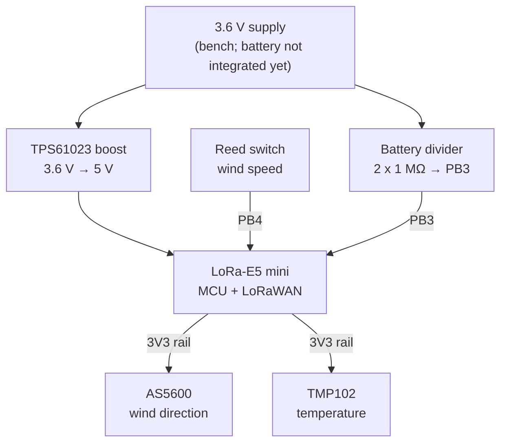

# DOCUMENT 4 — INTERFACE CONTROL DOCUMENT (ICD)

**Project:** Urban Wind Sensor Network  
**Version:** 1.1 — Hardware interfaces (aligned with `firmware/include/config.h`)  
**Main controller:** Seeed LoRa-E5 mini (STM32WLE5JC)

## 1. Purpose

This document is the hardware reference for the node: what connects to what, on which pin and at which voltage. Pin values are taken from `config.h`, which stays the source of truth for the code; if a pin changes, change both.

## 2. Schematic

<!-- TODO: insert Lina's schematic here, e.g.  -->

*Figure 1 — Node schematic (to be inserted).*

## 3. Pin Mapping

| Function | Pin | Connected hardware | Notes |
|---|---|---|---|
| I²C SDA | PA15 (I2C2) | AS5600 (0x36), TMP102 (0x48) | shared bus |
| I²C SCL | PB15 | AS5600, TMP102 | shared bus |
| Wind-speed pulse | PB4 | Reed switch to GND | internal pull-up, edge interrupt, debounce 2 ms (`REED_DEBOUNCE_US`, caps at 500 Hz) |
| Battery sense | PB3 | Divider: battery + → R1 → PB3 → R2 → GND | R1 = R2 = 1 MΩ, ratio 2.0, 12-bit ADC, Vref 3.3 V |
| Sensor power gating | none | — | `PIN_ANEMO_POWER = -1`: AS5600 permanently on 3V3 (see PowBudg) |
| Power in | 5 V / GND | TPS61023 output | board generates its own 3V3 rail |

**Do not use:** PA4, PA5 (RF switch), PB0 (radio TCXO), PB13 (BOOT button), PA13/PA14 (SWD).

Devices on the I²C bus:

| Device | Address |
|---|---|
| AS5600 (wind direction) | 0x36 (fixed) |
| TMP102 (temperature, ADD0 on GND) | 0x48 |

The I²C pull-ups go to the 3V3 rail (ICD-06).

## 4. Power Distribution

| ID | Source | Destination | Voltage |
|---|---|---|---|
| PWR-01 | Bench supply (battery later) | TPS61023 input and battery divider | 3.6 V |
| PWR-02 | TPS61023 output | LoRa-E5 mini 5 V input | 5 V |
| PWR-03 | LoRa-E5 mini 3V3 rail | AS5600, TMP102, I²C pull-ups | 3.3 V |
| PWR-04 | All returns | Common ground | 0 V |

*Figure 2 — Power distribution.*

Constraints:

1. The 3.6 V supply must never be connected directly to a 3.3 V-only pin.
2. The boost converter must supply the peak current of a LoRa transmission without brown-out (ICD-08).
3. I²C pull-ups and all signals stay at 3.3 V.
4. All parts share one ground.

## 5. Sensor Interfaces

| Sensor | Interface | Notes |
|---|---|---|
| Anemometer (3-cup rotor, magnet + reed switch) | Digital pulse on PB4 | one pulse per magnet passage; magnets per revolution to define (ICD-03) |
| Wind direction (AS5600) | I²C 0x36, 12-bit angle | diametrically magnetised magnet on the vane axis; no mechanical contact; air gap per datasheet (ICD-04, ICD-05); north offset applied by calibration, never hard-coded |
| Temperature (TMP102) | I²C 0x48 | one-shot conversion, 35 ms; read every 10th wind sample; offset applied by calibration |
| Battery voltage | ADC on PB3 | flagged low below 3.3 V (`LOW_BATTERY_V`) |

## 6. Interface Verification

Hardware checks use the firmware tests listed in `docs/testing.md`, in this order: `test_board` (supply, deep sleep), `test_i2c` (0x36 and 0x48 found), `test_temperature`, `test_as5600` (magnet detected, angle smooth over 0–360°), `test_reed` (one pulse per magnet, no doubles), `test_battery` (within 0.05 V of a multimeter).

Bench checks before powering the board: stable 3.6 V at the input, stable 5 V at the TPS61023 output, correct common ground, 3.3 V on the I²C lines.

## 7. Open Hardware Decisions

| ID | Decision | Status | Team |
|---|---|---|---|
| ICD-01 | GPIO mapping | **Closed**: PA15, PB15, PB4, PB3 | Electronics |
| ICD-02 | Reed switch or Hall sensor | **Closed**: reed switch | Electronics |
| ICD-03 | Magnet count and spacing on the rotor | Open | Mechanical + Electronics |
| ICD-04 | AS5600 magnet and alignment | Open | Mechanical |
| ICD-05 | AS5600 air gap | Open | Mechanical |
| ICD-06 | I²C pull-up values | Open (voltage: 3V3) | Electronics |
| ICD-07 | Power-gating of the AS5600 (needs a power pin; decides the power-budget scenario) | **Open, high impact** | Electronics + Firmware |
| ICD-08 | TPS61023 peak-current capability during TX | Open | Electronics |
| ICD-09 | MOSFET and switched 5 V load | **Dropped** unless ICD-07 needs a switch | Electronics |
| ICD-10 | Connectors and wiring | Open | Integration |
| ICD-11 | Insert schematic (Lina) | Open | Electronics |
